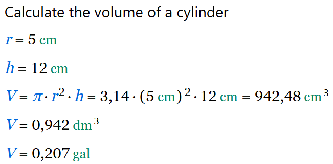

<div align="center">


# CalcpadCE

**开源工程计算书编辑器：语法简单，实时渲染漂亮的结果。**

[English](README.md) | **中文**

[](https://github.com/imartincei/CalcpadCE/actions)
[](https://github.com/imartincei/CalcpadCE/releases/latest)
[](https://opensource.org/licenses/MIT)
</div>

<br>

## 📖 CalcpadCE 是什么？

CalcpadCE 是一款开源的数学与工程计算工具。用简单、可读的语法写公式，就能实时得到排版好的结果，附带图表、示意图和格式化输出。支持桌面端、Web 和 Visual Studio Code。

本项目是已转为闭源的 Calcpad 7.6.2（2026 年 3 月）的分支。

🡒 **[查看文档](https://imartincei.github.io/CalcpadCE/)**

🡒 **[浏览 200+ 个示例](https://imartincei.github.io/CalcpadCE/examples/getting-started.html)**

**核心特性：**

* **高等数学**：原生支持实数、复数、向量、矩阵，以及数值积分、微分、求根、FFT 等数值方法。
* **单位自动跟踪**：内置 SI、英制和美制（USCS）单位，也可自定义单位。
* **可编程**：自定义函数、宏、条件判断、循环、文件读写（CSV / Excel ）。
* **富文档**：可在代码旁直接嵌入 Markdown、HTML、CSS 和参数化 SVG 图形。
* **专业报表**：自动生成交互式 HTML 输入表单，导出带 Word  公式或 PDF  的精排版报告。


## 🚀 下载与安装

最新桌面版可从 GitHub Releases 下载，提供 Windows 安装包、免安装便携版和 Linux 包。

**VS Code 扩展：**
如果你习惯在 IDE 里写计算书，我们维护了专用的 Visual Studio Code 扩展，提供语法高亮、代码片段等功能。

🡒 **[下载](https://github.com/imartincei/CalcpadCE/releases/latest)**

🡒 **[在线编辑器](https://calcpad-ce.org/)**

Windows 上最省事的安装方式是通过 [winget](https://learn.microsoft.com/en-us/windows/package-manager/winget/)：

```powershell
winget install -e --id Imartincei.CalcpadCE
```

## ⚡ 快速开始

写一份 CalcpadCE 计算书，就像敲数学公式、加注释一样简单。

### 代码

```mathlab
' 计算圆柱体积
r = 5 cm
h = 12 cm
V = π * r^2 * h
V|dm^3
V|gal
```

### 输出



界面语言可在**设置 → 语言**中切换（自动 / English / 中文）。

## 🌐 社区与资源

无论是刚上手需要帮助，还是想和其他用户交流，都可以在这里找到我们：

* **[官方网站](https://calcpad-ce.org/)**
* **[文档](https://imartincei.github.io/CalcpadCE/)**
* **[快速参考](https://imartincei.github.io/CalcpadCE/quick-reference.html)**
* **[GitHub Discussions](https://github.com/imartincei/CalcpadCE/discussions)**
* **[Discord 服务器](https://discord.gg/NMttSUhZss)**

## 🏛️ 项目状态与历史

原 Calcpad 作者转为闭源模式后，其公开 GitHub 仓库下线。

社区接手了项目分支，继续开源开发。我们把最后一个开源版本恢复出来，正式发布 CalcpadCE，作为这款软件免费的、社区驱动的延续。

我们的目标是让这个优秀工具始终有一个免费、开源、有人维护并持续改进的版本。

## 🤝 参与贡献

CalcpadCE 完全由志愿者维护，欢迎各种规模的贡献！无论是修 bug、加一种数值方法，还是改进文档，都很有价值。

开始之前，请先检出仓库、本地构建，并浏览 open issues。如果计划做较大的功能，建议先开一个 Discussion 与维护者沟通。

🡒 **[贡献指南](CONTRIBUTING.md)**

## 🛠️ 从源码构建

安装 [.NET 10 SDK](https://dotnet.microsoft.com/en-us/download/dotnet/10.0)、[Node.js](https://nodejs.org/) 22+ 和 [Rust](https://rustup.rs/)。

桌面端是用 [Tauri](https://tauri.app/) 包住 CalcpadCE Web 前端的壳，计算服务作为 sidecar 一起打包。先在下面三个前端项目里装依赖，然后启动桌面端：

```shell
git clone https://github.com/imartincei/CalcpadCE.git
cd CalcpadCE/Calcpad.Web/frontend/calcpad-frontend
npm install
cd ../calcpad-web
npm install
cd ../calcpad-desktop
npm install
npm run dev
```

要生成当前平台的安装包，在同一目录运行 `./build-desktop.sh`（Windows 用 `.\build-desktop.ps1`）。

命令行解释器可独立构建：在仓库根目录运行 `dotnet build Calcpad.Cli`。它主要作为开发工具，用来渲染文档中的示例，不随正式版发布。

### VS Code 任务

仓库内置了常用构建任务，可从 **终端 → 运行任务…**（`Ctrl+Shift+P` → *Tasks: Run Task*）调用，会自动选择当前平台的脚本。

| 任务 | 作用 |
| ---- | ---- |
| `Frontend: Install All Dependencies` | 为前端库、Web 编辑器、扩展和桌面端统一执行 `npm install` |
| `Desktop: Stage Sidecar` | 发布 `Calcpad.Server` 并放入 Tauri sidecar 目录 |
| `Desktop: Dev` | 启动带热重载的 `tauri dev`，会先准备 sidecar |
| `Desktop: Bundle All` | 构建当前平台配置的所有安装包格式 |
| `Desktop: Build Portable (Windows)` | 构建 Windows 便携版 |
| `Server: Build (.NET)` | 构建 `Calcpad.Server` 后端 |
| `Web: Dev Server` | 用 Vite 开发服务器运行浏览器版编辑器 |
| `Extension: Compile` | 构建 VS Code 扩展并把服务端部署进去 |
| `Tests: Run` | 运行 `Calcpad.Tests` |

**运行和调试**里还提供 `Desktop: Dev (Tauri)` 和 `Server: Debug (.NET)` 两个启动配置。

## 📄 许可证与致谢

CalcpadCE 以 **MIT 许可证**发布。

本项目建立在原 Calcpad 的卓越基础之上。
Copyright (c) 2014-2026 Ned Ganchovski.
后续修改与新增内容 Copyright (c) 2026 CalcpadCE Contributors.

项目还使用了若干第三方组件、软件和设计，均按各自作者的许可条件免费再分发：
1. 新图标使用 [icons8.com](https://icons8.com/) 制作。
2. 部分符号使用 [indestructible type\*](https://indestructibletype.com/) 的 Jost\* 字体，遵循 [SIL 开源字体许可](https://scripts.sil.org/cms/scripts/page.php?item_id=OFL_web)；方括号为适配应用做了微调。
3. Web、桌面和 VS Code 编辑器默认字体为 cormullion 的 [JuliaMono](https://github.com/cormullion/juliamono)，遵循 [SIL 开源字体许可](https://scripts.sil.org/cms/scripts/page.php?item_id=OFL_web)。
4. 计算输出使用 DejaVu fonts 团队的 [DejaVu Serif Condensed](https://dejavu-fonts.github.io/) 字体，遵循 [DejaVu Fonts License](https://dejavu-fonts.github.io/License.html)（Bitstream Vera 衍生许可）。
5. 预览中的交互式数据表格由 Paul Hodel 的 [jspreadsheet-ce](https://github.com/jspreadsheet/ce) 和 [jsuites](https://github.com/jsuites/jsuites) 提供，遵循 [MIT 许可](https://opensource.org/licenses/MIT)。
